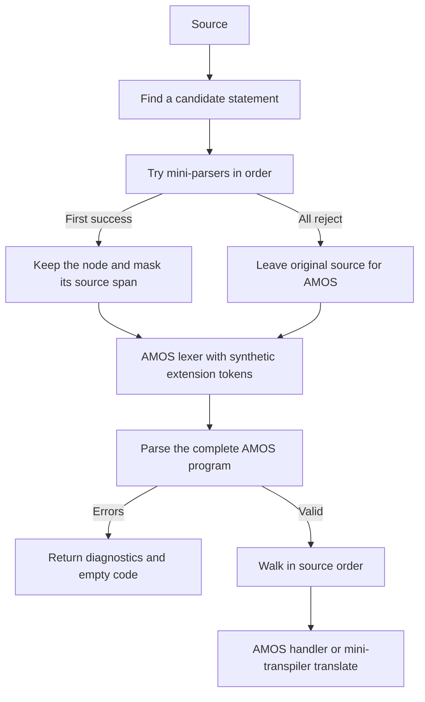

# EXTENSIONS

At each supported statement boundary, CRVJA tries extension parsers in alphabetical
folder order. The first complete, error-free parse wins. If every extension rejects
the fragment, its original text stays in the AMOS program.

Paths below are relative to `src/transpilers/2.0.0-beta/`; npm commands run from the
backend root. `amos-transpiler.js` is the public entry point, `core/` holds shared
translation services, and `extensions/` holds integration helpers and mini-transpilers.

## Install an extension

Place a mini-transpiler in an immediate subdirectory of `extensions/`. The entry
filename follows the folder name; no descriptor or command registration is needed:

```text
extensions/example/
  example-transpiler.js
  Example.g4
  commands.js
  generated/
```

The entry module exports a class with two synchronous methods:

```javascript
export default class ExampleTranspiler {
  parse(source) {
    // Use your lexer/parser to recognize the entire fragment.
    // Return your command node, or null on lexical/syntax errors or trailing input.
  }

  translate(node, context) {
    // Translate only the accepted node using context.expressions and context.emit().
  }
}
```

`amcaf/amcaf-transpiler.js` is the complete ANTLR example. Its `parse()` follows the
original transpiler skeleton: input, lexer, diagnostic listener, token stream,
parser, and tree. The entry rule ends with `EOF`. ANTLR's default error recovery
may produce a tree, but any lexical or syntax diagnostic rejects that attempt.
No custom error strategy or exception is required.

Parsing must not emit code or mutate translation state. Every trial gets its own
lexer/parser state. A rejected attempt returns exactly `null`; a successful one
returns a node object. Programming exceptions propagate instead of being hidden
as syntax failures. Async methods are unsupported.

`translate()` receives a `TranslationContext`, shared with core handlers. It exposes
`context.expressions.translate(node)`, `context.emit(code)`, `context.declareVariable(name)`,
and the current program's scope and state. This API replaces the previous translator host;
`handleExpression`, `expr`, and handler forwarding methods are removed.

Handlers are standalone classes whose constructors store `this.context` and
`this.expressions`, or they can use the context directly. A mini-transpiler can lazily construct a
local `HandlerDispatcher` and reuse it for later statements. The dispatcher binds methods
to their instances and resolves `enterX`, `exitX`, and `visitX` through owning parser rule
names. It does not register the extension's commands globally.

For example, a statement handler can reuse core expression translation:

```javascript
class Commands {
  constructor(context) {
    this.context = context;
    this.expressions = context.expressions;
    this.lineCounter = 0;
  }

  enterTurboDraw(ctx) {
    const x1 = this.expressions.translate(ctx.expression(0));
    const y1 = this.expressions.translate(ctx.expression(1));
    const x2 = this.expressions.translate(ctx.expression(2));
    const y2 = this.expressions.translate(ctx.expression(3));
    const colour = this.expressions.translate(ctx.expression(4));
    const layer = this.expressions.translate(ctx.expression(5));
    const id = `exampleLine_${this.lineCounter++}`;
    this.context.emit(`turboDrawLine('${id}', ${x1}, ${y1}, ${x2}, ${y2}, ${colour}, ${layer});`);
  }
}
```

The counter gives each source statement a distinct ID, as AMCAF does. Repeated execution
of the generated statement reuses its ID. The translation entry point uses the dispatcher:

```javascript
translate(node, context) {
  this.dispatcher ??= new HandlerDispatcher([new Commands(context)]);
  const handler = this.dispatcher.get('enter', node);
  if (!handler) throw new Error(`No statement handler for ${getRuleName(node)}`);
  handler(node);
}
```

Import `HandlerDispatcher` and `getRuleName` from `../../core/handler-dispatcher.js` in an
immediate extension subdirectory. The shared diagnostic listener is available at
`../../core/amos-error-listener.js`; grammar imports remain under `../../grammar/`.
Handler constructors receive the shared context directly.
Keep parsing independent: its trials must not construct or mutate the translation context.
Each transpilation gets fresh mini-transpiler instances and local dispatchers, so counters
do not leak between programs. Core expression handlers remain available through the shared
expression service; extension functions inside core expressions remain deferred.

The loader rescans folders on each call and skips folders without the conventional
entry file. Node caches imported modules; restart the process after changing an
already imported module. Folder names use JavaScript's default case-sensitive
string sort. `new AMOSTranspiler({ extensionsDirectory })` selects another directory
using a path or file URL, including an empty directory for core-only parsing.

## Program flow



- `ExtensionLoader` discovers and instantiates mini-transpilers.
- `StatementScanner` reads strings, comments, brackets, and statement boundaries.
- `ExtensionStatements` tries parsers and masks only accepted spans.
- `ExtensionTokenSource` inserts accepted nodes into the AMOS token stream.
- The AMOS tree walker calls `translate()` at the original statement position.

Commands can start at input start, after a newline or colon, or after inline
`Then`/`Else`. They end at a newline, comment, EOF, or top-level colon/`Else`.
Strings and brackets protect separators within arguments. Comments follow the
current AMOS apostrophe and `Rem` rules. After an unsuccessful trial, scanning
continues so a later inline `Then`/`Else` can introduce an extension statement.
Multiline commands and adjacent commands without these boundaries are unsupported.

Masking uses equal-length spaces and excludes line endings. Synthetic tokens carry
the extension-owned nodes, preserving their position in procedures, loops, and
branches. No translator is called until the complete AMOS program passes validation.
The shared context carries the active scope when extension translation runs.

AMCAF imports AMOS expressions. Independently generated grammars have different
token IDs and context classes, so expression dispatch uses the owning parser's
rule names, and identifier normalization uses the owning parser's symbolic token names.
Accepted trees normalize variables and routine names to uppercase, retain the float
mapping `NAME#` to `NAME_f`, and preserve label spelling and quoted strings.

## Intentional PoC policies

Extensions run before core AMOS. First success wins even if later extensions or
AMOS could also accept the same syntax. There are no duplicate-prefix checks,
keyword reservations, ambiguity reports, or rankings of failed attempts.

Failed extension diagnostics are discarded. When no extension accepts a fragment,
only the complete AMOS parse determines diagnostics. In particular:

- `Turbo = 1` remains a core assignment.
- Four-operand `Turbo Draw` can be accepted by AMOS as a procedure call followed
  by core `Draw`; investigating that interpretation is deferred.
- Unsupported AMCAF forms also fall back to AMOS, which may accept or reject them.

Supported AMCAF statements remain six-operand `Turbo Draw` and rectangular
`Blitter Clear`:

```basic
Screen Open 0,320,256,8,Lowres
Turbo Draw 0,0 To 100,100,1,-1
Blitter Clear 0,0,0,0 To 100,100
```

`turboDrawLine` stays in `core/amos-runtime.js`, included once in every successful
program. Other extensions may provide an optional `runtimeSource` string on their
mini-transpiler instance; the context includes it once when that instance is used.

## Generation and validation

From the backend directory:

```sh
npm run antlr
npm test -- --runInBand src/transpilers/2.0.0-beta/tests
```

`npm run antlr` invokes `grammar/generate-grammars.mjs`, using the existing ANTLR JAR
to generate AMOS before the extension grammars. It discovers `.g4` files in immediate
extension subdirectories, supplies the core grammar import path, and formats generated
JavaScript with Prettier. Only this version's generated files are written.
Run it after adding or changing a grammar; handler-only changes do not require it.
The generator is a development tool and does not run during transpilation.

### Why 11 tests are skipped

The statement-only PoC explicitly defers extension functions such as `Qsin` and
`Qcos`. The 11 skipped cases in
[amcaf.spec.js](src/transpilers/2.0.0-beta/tests/amcaf.spec.js) require those functions:

| Cases | Required functionality |
| --- | --- |
| 2 | Nested extension functions and float variables |
| 1 | Extension functions in conditions |
| 1 | An extension function inside a procedure |
| 1 | An extension function as a drawing operand |
| 6 | AMCAF trigonometry and argument expressions |
| **11** | **Total** |

For example, the engine supports a complete statement such as
`Turbo Draw 10,10 To 400,400,2,0`, but does not yet integrate extension functions
inside expressions such as `X = Qcos(0,10)` or
`Turbo Draw Qsin(256,10),0 To 100,100,2,0`.

The skipped test bodies are retained as acceptance tests for future function support.
Re-enable them when extension functions work in expressions, including nested calls,
conditions, procedure scope, and statement arguments. Separate active tests cover
statement ordering, procedures, loops, branches, and core expression reuse.

These skips predate the naming cleanup and represent a known functionality gap.
Passing the active suite does not establish that extension functions work.

## Deferred work

- Command ownership, ambiguity reporting, and better fallback diagnostics.
- Extension functions and nested cross-extension calls; existing function-dependent
  test bodies remain explicitly skipped.
- ZIP upload infrastructure and shared discovery with the binary decoder.
- Preservation of native extension token identities.
- Multiline constructs, new operators, and broader grammar composition.
- Remaining AMCAF commands and semantic completeness.
- Moving runtime behavior into translators while preserving exactly-once operand
  evaluation and evaluation order.
- General validation of unknown procedure/array names, AST normalization, and
  broader semantic transformations.
