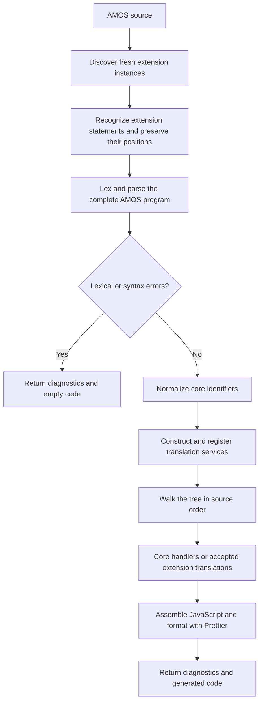
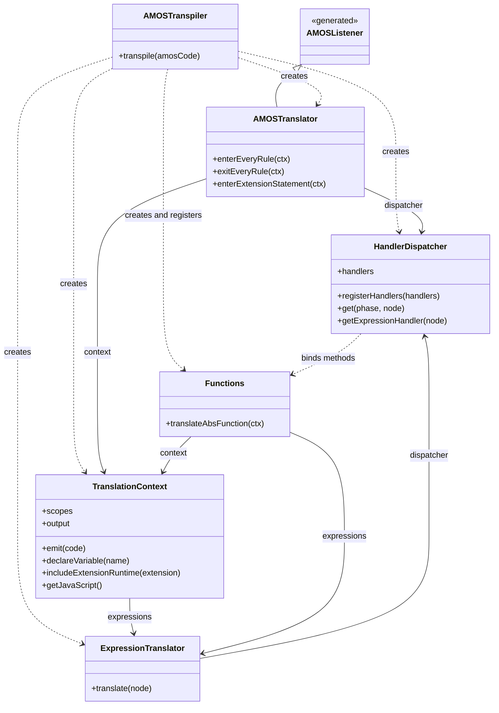
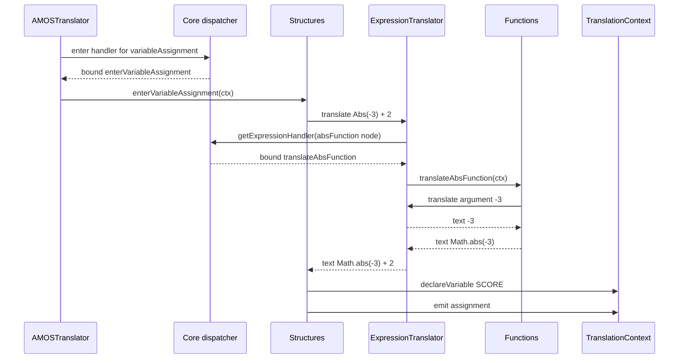

# Transpiler architecture

The beta transpiler separates orchestration, command semantics, expression translation,
and shared program state. This guide explains how those parts work together.
For implementation steps, see [COMMANDS.md](COMMANDS.md); for mini-transpilers, see
[EXTENSIONS.md](EXTENSIONS.md).

Paths below are relative to `src/transpilers/2.0.0-beta/` unless linked explicitly.
Run npm commands from the backend root. New work targets this version; older versions
keep their existing behavior.

1. [File layout and parser generation](#1-file-layout-and-parser-generation)
2. [Translation pipeline](#2-translation-pipeline)
3. [Translation services](#3-translation-services)
4. [A complete example](#4-a-complete-example)
5. [Execution and diagnostics](#5-execution-and-diagnostics)

## 1. File layout and parser generation

### 1.1. Entry point and supporting files

```text
src/transpilers/2.0.0-beta/
├── amos-transpiler.js          Public entry point
├── core/
│   ├── amos-translator.js     ANTLR listener
│   ├── amos-error-listener.js Diagnostics and source positions
│   ├── handler-dispatcher.js  Bound handler lookup
│   ├── expression-translator.js
│   ├── translation-context.js
│   └── amos-runtime.js        Browser code included in generated programs
├── commands/                 Core handlers, organized by AMOS category
├── grammar/
│   ├── AMOS.g4
│   ├── normalize-identifiers.js
│   ├── generate-grammars.mjs
│   └── generated/            Generated lexer, parser, and listener
├── extensions/               Integration helpers and mini-transpiler folders
└── tests/
```

[amos-transpiler.js](../src/transpilers/2.0.0-beta/amos-transpiler.js) is the entry point.
Shared translation services live in `core/`; command behavior lives in `commands/`.
Grammar tooling stays beside the syntax definitions it processes.

### 1.2. Generate parsers during development

```sh
npm run antlr
```

This runs [generate-grammars.mjs](../src/transpilers/2.0.0-beta/grammar/generate-grammars.mjs),
which uses the bundled ANTLR JAR to:

1. Generate AMOS into `grammar/generated/`.
2. Discover `.g4` files in immediate extension subdirectories and generate their parsers.
3. Supply the core grammar import path through ANTLR's `-lib` option.
4. Format the generated JavaScript with the project's Prettier configuration.

Generation uses `-no-visitor`: expression translation is implemented by the shared
`ExpressionTranslator`, and no generated visitor classes are needed. The command also
removes stale visitor files from earlier generations.

Java is required for generation. Regenerate after changing or adding a grammar and include
its generated artifacts with the change. Handler-only edits need no regeneration.
The running backend imports these generated files directly; it does not invoke the generator
for each request.

## 2. Translation pipeline

### 2.1. Validate before generating JavaScript



Extension parsers recognize candidate statements before core parsing. Accepted statements
are represented in the AMOS tree by synthetic tokens carrying their extension-owned nodes.
The [extension integration guide](EXTENSIONS.md#4-statement-integration) explains recognition,
masking, and fallback.

The core lexer creates tokens; the parser organizes them into statements and expressions.
If either reports errors, translation services are not constructed and no JavaScript is
returned. This keeps failed parser attempts from leaving partial output or scope changes.

### 2.2. Normalize names after parsing

ANTLR's `caseInsensitive` option changes matching while preserving token text.
[normalize-identifiers.js](../src/transpilers/2.0.0-beta/grammar/normalize-identifiers.js)
then normalizes identifier tokens in accepted trees:

| AMOS name or content | Translation behavior |
| --- | --- |
| `score`, `Score`, `SCORE` | All become `SCORE` |
| `values`, procedure names, parameters, `DEF FN` names | Uppercase identifiers |
| `name$` | `NAME$`; the string suffix stays intact |
| `position#` | `POSITION_f`; `#` is replaced for JavaScript |
| Any capitalization of unsuffixed `Timer` | Keeps the runtime binding `Timer` |
| Label definitions and label references | Preserve spelling |
| Quoted strings, filenames, AMAL text inside strings | Preserve contents |

Label preservation retains the current resolution behavior; it does not implement additional
label support. The pass distinguishes an `On … Gosub` dispatch variable from its label targets
and leaves the untranslated `Restore` subtree intact.

AMCAF normalizes its own accepted trees before returning them. Both passes identify tokens
through their owning parser's symbolic names, since numeric token IDs differ across grammars.
Never uppercase the entire source: strings and diagnostic positions must survive unchanged.

## 3. Translation services

### 3.1. Responsibilities and construction

| Class | Responsibility |
| --- | --- |
| [AMOSTranspiler](../src/transpilers/2.0.0-beta/amos-transpiler.js) | Parse, construct services, walk, format, and return the result |
| [AMOSTranslator](../src/transpilers/2.0.0-beta/core/amos-translator.js) | Forward enter/exit events and invoke accepted extensions |
| [HandlerDispatcher](../src/transpilers/2.0.0-beta/core/handler-dispatcher.js) | Register and resolve bound handler methods |
| [ExpressionTranslator](../src/transpilers/2.0.0-beta/core/expression-translator.js) | Translate expression structure and invoke function handlers |
| [TranslationContext](../src/transpilers/2.0.0-beta/core/translation-context.js) | Own program state, declarations, output, runtime inclusion, and assembly |
| `Instructions`, `Structures`, `Functions` | Implement individual commands |

The diagram focuses on the core translation services. `Functions` represents the shared
service references used by all three handler categories; `Instructions` and `Structures`
are omitted for readability. All three are standalone classes, with no shared handler
superclass. The generated `AMOSListener` is included to show the listener's inheritance;
lexer, parser, walker, and extension integration classes are covered by the pipeline above.



The hollow triangle denotes inheritance. Solid arrows show stored references, labeled with
their attribute names; dashed arrows show creation or registration dependencies.
The services are created as local variables in `transpile()` and injected into their
consumers, so these relationships do not imply composition or exclusive ownership.
The dispatcher stores bound callbacks in its `enter`, `exit`, and `expression` maps, retaining
their handler instances through those callbacks.

After successful parsing and normalization, the entry point constructs the dependencies:

```js
const dispatcher = new HandlerDispatcher();
const expressions = new ExpressionTranslator(dispatcher);
const context = new TranslationContext(expressions);

dispatcher.registerHandlers([
  new Instructions(context),
  new Structures(context),
  new Functions(context),
]);

const translator = new AMOSTranslator(context, dispatcher);
const walker = new antlr4.tree.ParseTreeWalker();
walker.walk(translator, tree);
```

The dispatcher starts empty so the expression service and context can exist before handler
construction. Registration finishes before walking begins. Every transpilation creates fresh
services and handler instances, preventing declarations, counters, and colours from leaking
between programs.

### 3.2. Handler dispatch and traversal

The dispatcher builds lookup maps once, following the handler method-name convention:

| Method | Called by | Purpose |
| --- | --- | --- |
| `enterX(ctx)` | Statement listener | Emit a statement or open a block |
| `exitX(ctx)` | Statement listener | Close a block or restore state |
| `translateX(ctx)` | Expression translator | Return a JavaScript expression fragment |

Methods are bound to their handler instances, preserving `this` when called later.
`enterX` and `exitX` map to listener-event handlers; `translateX` maps to the expression
handler category. `ExpressionTranslator` retrieves those callbacks through
`dispatcher.getExpressionHandler(node)`. These methods return JavaScript source text;
they do not use ANTLR visitor dispatch. Duplicate handlers for the same category and rule
within a dispatcher raise an error.

Rule lookup uses `node.parser.ruleNames[node.ruleIndex]`. An independently generated AMCAF
node therefore works even though its rule index and context class differ from AMOS.
Condition translation uses the same rule-name approach.

`AMOSTranslator` forwards traversal events without owning program state:

```js
enterEveryRule(ctx) {
  const handler = this.dispatcher.get('enter', ctx);
  if (handler) handler(ctx);
}
```

Unhandled enter/exit events are harmless: many grammar nodes merely group other nodes.
The walker does not call `translateX` methods. Descending through an assignment's expression
therefore does not repeat the function translation already requested by its handler.

### 3.3. Expression translation

`ExpressionTranslator.translate(node)` handles inputs explicitly:

| Input | Result |
| --- | --- |
| Missing node | Empty string |
| Array of nodes | Array of translated results |
| Terminal token | Token text |
| Expression, term, factor, parentheses, array access | Recursively translated syntax |
| Function or other value-producing rule | Result of its registered `translateX` handler |

The expression layers preserve precedence and unary minus. For example,
`A(I)+Abs(-X)*2` becomes `A[Math.trunc(I)] + Math.abs(-X) * 2`.
An unregistered rule requiring an expression handler raises a clear internal error.

Handlers call this service directly. Nested functions recurse through smaller child nodes
and function handlers, without routing through the statement listener. Translation returns
source text such as `Math.abs(SCORE)`; the numeric operation happens when that code runs.

### 3.4. Shared state and output

Two similarly named objects have different lifetimes:

- **`ctx`** is one ANTLR parse-tree node describing syntax.
- **`context`** is the `TranslationContext` shared throughout one transpilation.

Handlers retain `context` and `context.expressions` in their constructors. The context owns
scopes, declarations, loop tracking, colour state, data bookkeeping, and output sections.
Its scope objects record declarations and defaults, not live AMOS variable values.

`declareVariable(name)` avoids duplicate declarations in the current scope and respects
`Global` bookkeeping. Numeric defaults are `0`; string defaults are `""`. Root declarations
go into a separate section; procedure-local declarations go into the body at their scope.
Procedure handlers push/pop scopes and account for parameter bindings and local defaults.
Extensions encountered there receive that same active context.

`emit(code)` appends body code in traversal order. `includeExtensionRuntime(extension)` adds
an optional runtime once per used extension instance. `getJavaScript()` joins these sections:

```text
Version comment → colour palette → global declarations → function support
→ shared and optional extension runtimes → translated body
```

Keeping declaration and runtime support before the body lets statements use them without
managing output ordering themselves.

## 4. A complete example

### 4.1. Parse and translate an assignment

```basic
Screen Open 0,320,200,16,Lowres
score = Abs(-3) + 2
Plot score,10
Turbo Draw Abs(score),10 To score+30,20,2,-1
```

This program exercises screen setup, a variable, a core function, drawing, and an AMCAF
statement. AMCAF recognizes the final statement; the complete core parse succeeds; accepted
identifier references become `SCORE`.

The walker first invokes `Instructions.enterScreenOpen`, which emits browser screen setup.
For the assignment, it then selects `Structures.enterVariableAssignment`:



The context records `SCORE` and prepares `let SCORE = 0;`. The assignment handler emits
`SCORE = Math.abs(-3) + 2;`. It does not calculate or store the result `5` during transpilation.
The [ABS walkthrough](COMMANDS.md#4-implement-a-function-abs) shows the function handler.

### 4.2. Translate core and extension drawing statements

`Instructions.enterPlot` translates its two arguments into the text `SCORE` and `10`, then
emits DOM operations. It uses the same expression service as the assignment handler.

For the final statement, `AMOSTranslator.enterExtensionStatement` retrieves the saved AMCAF
node and invokes `extension.translate(node, context)`. AMCAF's local dispatcher selects its
`enterTurboDraw` handler. That handler translates all six operands through the shared
expression service, which can resolve the core `Abs` function through the core dispatcher.

There are two dispatchers, each owning its handlers. Both sets of handlers share the same
context and expression service. See the [extension example](EXTENSIONS.md#3-translate-with-shared-services)
for the implementation.

### 4.3. Assemble the result

After the walk, the entry point formats `context.getJavaScript()` with Prettier.
The generated program contains these statements among its runtime and drawing code:

```js
let SCORE = 0;

// Shared runtime and screen setup omitted from this excerpt.
SCORE = Math.abs(-3) + 2;

// PLOT creates a pixel at (SCORE, 10).
turboDrawLine('turboDraw_0', Math.abs(SCORE), 10, SCORE + 30, 20, 2, -1);
```

Only browser execution sets `SCORE` to `5` and draws the point and line. The extension's
counter assigns an ID to the source statement; repeated execution reuses that line's ID.

## 5. Execution and diagnostics

### 5.1. Browser runtime boundary

The frontend's [AMOS runner](../../reanimate-CRVJA-frontend/src/app/components/cina/amos-runner.js)
executes generated JavaScript in an asynchronous function inside an iframe containing
`#game-container`. `Screen Open` creates `#amos-screen`; drawing commands use it.
The asynchronous wrapper permits generated `await` operations such as `Wait`.

[core/amos-runtime.js](../src/transpilers/2.0.0-beta/core/amos-runtime.js) supplies shared browser
helpers. The context also includes the colour functions from
[amiga-color.js](../src/utils/amiga-color.js). The backend returns source code rather than
executing those browser operations. Runtime implementation guidance belongs in
[COMMANDS.md](COMMANDS.md#6-shared-services-and-browser-runtime).

### 5.2. Result and failure boundaries

`await new AMOSTranspiler().transpile(source)` returns:

```js
{
  lexicalErrors: { errors: [] },
  syntaxErrors: { errors: [] },
  translatedCode: '...formatted JavaScript...'
}
```

Lexical/syntax diagnostics contain `line`, `column`, and `msg`; lines are one-based and
columns are zero-based. They refer to the original source, including after extension masking.
Either kind of error produces empty `translatedCode`.

A successful parse establishes syntax acceptance, not complete AMOS semantic support.
Unimplemented commands, current label behavior, and internal translation errors remain
separate concerns. Programming errors such as missing required handlers propagate as
exceptions rather than being reported as syntax errors. The extension-specific boundaries
are documented in [EXTENSIONS.md](EXTENSIONS.md#6-limits-and-deferred-features).
